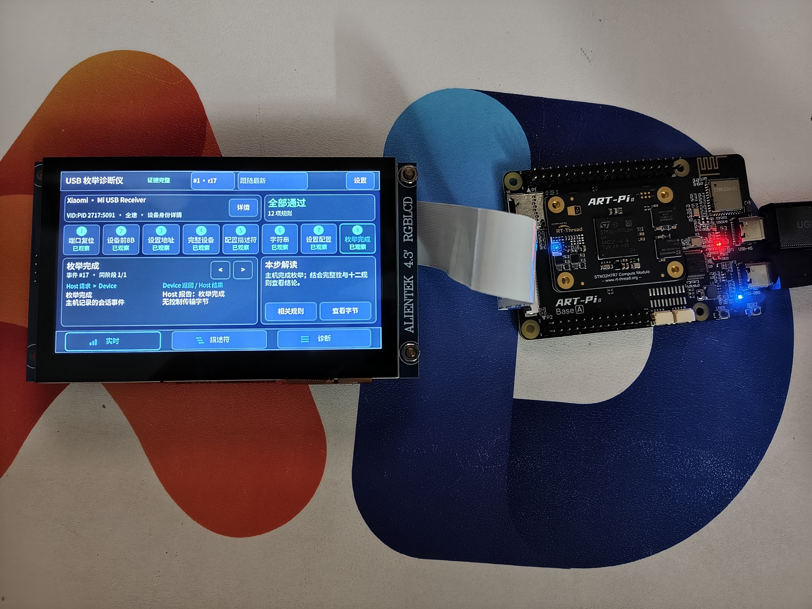
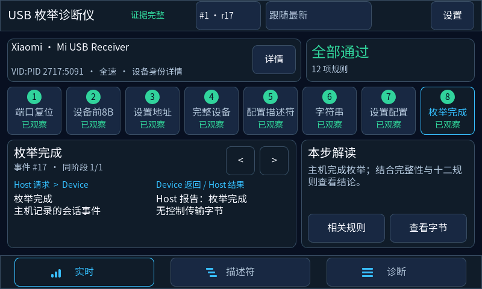
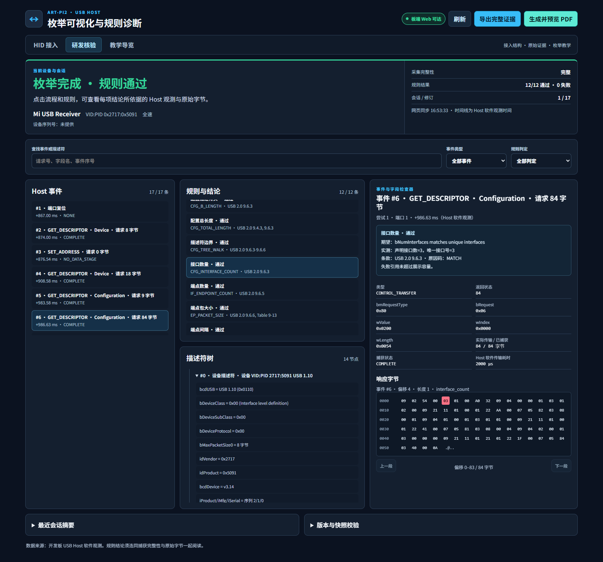
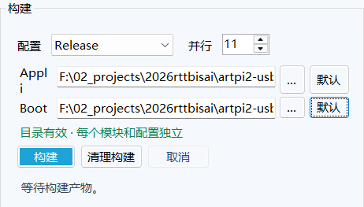
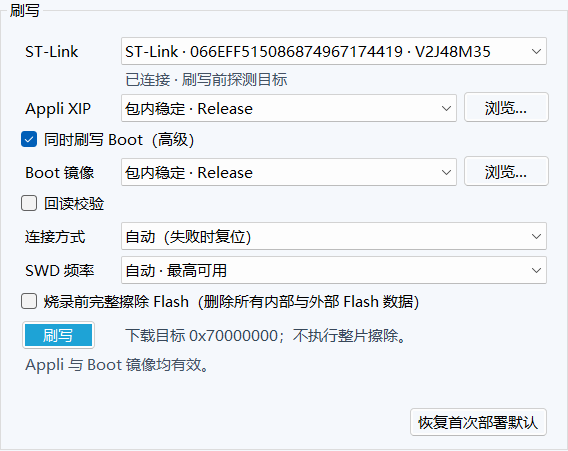
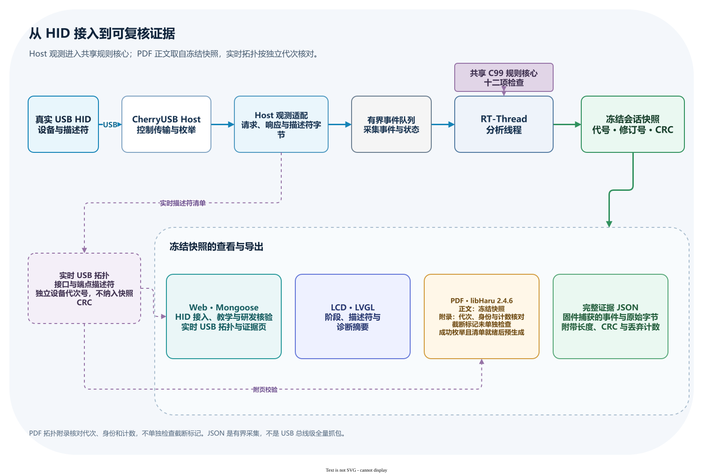
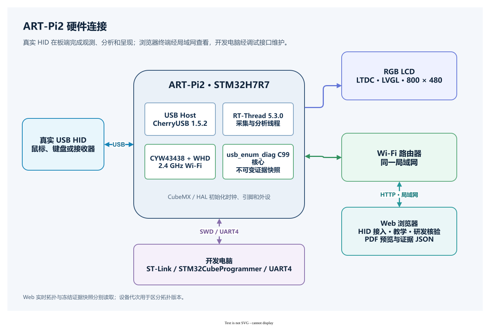

# ART-Pi2 USB 枚举可视化与描述符规则诊断仪

> [英文版](README_EN.md)

**识别成功之后，主机究竟看到了什么？**

主机会发出请求，设备会返回响应。接口和描述符也在这段过程中逐步出现。ART-Pi2 把真实 HID 枚举过程呈现在开发板的 LCD 和局域网网页上。你可以沿时间线看请求与响应，再从规则结论追到对应事件和原始字节。

*实机照片：屏幕显示一份已经完成的 HID 枚举快照。*

## 作品价值与适用场景

一份真实枚举记录，既能帮助你理解设备如何被识别，也能为接入调试和结果复核提供可追查的依据。

| 使用场景 | 可以查看和核对的内容 |
|---|---|
| 学习 USB 枚举 | 沿 8 阶段时间线查看主机请求、设备响应和配置过程，再完成 4 项证据核验任务 |
| 调试 USB 主机或 HID 接入 | 核对接口、端点、描述符完整性和主机类驱动绑定状态 |
| 追查规则结论 | 从 12 项规则的期望值、实测值和判定，找到来源事件与原始字节 |
| 保存或分享结果 | 在浏览器预览、下载或打印板端生成的 PDF；需要继续分析时，导出完整证据 JSON |

教学导览和研发核验围绕同一份板端会话快照展开。
固件与主机侧测试共用 C99 规则核心，保持规则判断一致。
主机侧可以单独构建和测试该核心。
它不依赖 RT-Thread、USB 控制器、LVGL 或网络栈，也不分配动态内存。

## 可复用组件与社区工作

USB 枚举规则、Wi-Fi 配置管理和看门狗故障记录核心已拆分为可独立构建的 C99 组件，并用于 ART-Pi2。项目提供组件源码、RT-Thread 集成入口和主机侧检查。

- [usb_enum_diag](packages/usb_enum_diag/README.md)
- [wifi_profile_manager](packages/wifi_profile_manager/README.md)
- [watchdog_crashlog](packages/watchdog_crashlog/README.md)

这些软件包目前随项目提供，尚未发布到 RT-Thread 软件包索引。本地准备的上游补丁候选不代表已提交或已合并的社区贡献。

## 功能界面

| 界面或功能 | 能查看和核对的内容 |
|---|---|
| LCD | 当前枚举状态、8 阶段流程、描述符、诊断信息和 Wi-Fi 设置 |
| HID 接入 | 实时接口与端点拓扑、接口类别、驱动绑定和描述符完整性 |
| 教学导览 | 8 阶段时间线、主机请求、设备响应和证据核验任务 |
| 研发核验 | 12 项规则、期望与实测值、来源事件、描述符字段和原始字节 |
| PDF 报告 | 成功枚举后由板端预生成的中文报告；默认遮盖设备序列号，不含原始传输负载 |
| 完整证据 JSON | 当前快照、规则结果、事件和固件捕获的原始字节，并保留 CRC 校验信息 |

## 实机界面

*Release 版 LVGL 首页实机画面，800 × 480。画面从正在运行的开发板显示帧缓冲中只读采集。*

*网页研发核验实机画面：Release 构建下的会话 1、修订 17。接口数量规则可追溯到主机事件 #6、偏移 4、原始字节 `0x03`。*

## 快速开始

ArtPi2Studio 是 ART-Pi2 的 Windows x64 图形工具，用来检查编译和刷写所需工具、构建 Debug/Release 固件并刷写开发板。构建与刷写分开操作；刷写前，界面会显示目标探针、镜像、地址和 SHA-256，供你核对。

如果板上已有固件且 Wi-Fi 已联网，可以从第 4 步开始。需要配置 Wi-Fi 时，从第 3 步开始；尚未刷写时，从第 1 步准备镜像。
屏幕请配套使用正点原子 ATK-MD0430R-800480 4.3 寸 RGB LCD 模块（800 × 480）。
初次使用还需要 ART-Pi2、真实 HID 设备和一台电脑。编译或刷写需要 Windows 10/11 x64；刷写还需要 ST-Link。查看网页时，电脑和开发板需要接入同一局域网。

### 1. 选择固件或编译

想先体验作品，可以直接使用比赛包预附的稳定 Release Boot 和 Appli 镜像。
若要从源码构建，打开比赛包根目录或开发目录中的 `ArtPi2Studio.exe`。选择 `Release` 或 `Debug`，再点击“构建”。

*选择 `Debug` 或 `Release`，确认 Appli 和 Boot 输出目录，再点击“构建”。*

构建不会自动刷写。成功后，Studio 会显示生成镜像的路径、大小和 SHA-256，并在当前会话选择匹配配置的新镜像。开发目录和比赛包都可构建 Debug 与 Release；比赛包预附的稳定镜像为 Release。

Studio 启动时会校验包内 STM32CubeProgrammer 2.23.0，并扫描 ST-Link；探针扫描不会连接或复位开发板。构建默认使用包内 CMake、Ninja 和 GNU Arm GCC。

首次构建发现包内工具尚未解压时，Studio 会检查磁盘空间并自动校验、解压。你也可以在工具设置中手动选择本机工具，或通过环境变量指定路径。CMake 需要 3.22 或更高版本；Ninja 与 GNU Arm GCC 按运行结果和目标架构检查。STM32CubeProgrammer 会检查命令能力和只读探针列表，本机版本不要求与包内 2.23.0 相同。
普通图形界面流程不需要安装 PowerShell、Node.js 或全局 .NET Runtime。
工具版本、构建目录和完整选项见[构建与运行指南](docs/competition/reproducibility.md)。

### 2. 首次刷写 Boot 和 Appli

镜像准备好后，连接 ST-Link，在刷写区域确认目标探针和镜像。Studio 会自动选择唯一探针。
若设置了 `ARTPI2_STLINK_SERIAL`，Studio 会优先选择对应探针。
未设置该变量且连接多台探针时，请按序列号选择目标。

若当前工程和配置还没有保存刷写选择，Studio 默认选用包内稳定 Release 镜像，并勾选 Boot 与 Appli。
回读校验默认关闭，你可以按需启用。
点击“恢复首次部署默认”可以恢复这些选择。
Boot 是启动程序，Appli 是应用固件。

*首次部署默认选择包内稳定 Release 镜像，并勾选 Boot 与 Appli；回读校验和完整擦除默认关闭。*

刷写前，检查确认页中的目标序列号、镜像来源、路径、地址和 SHA-256。

Boot 镜像写入微控制器内部 Flash 地址 `0x08000000`。
Appli 镜像写入外部 Flash 地址 `0x70000000`，并从该映射区就地执行（XIP）。
普通刷写只擦除镜像覆盖的扇区，保留 Wi-Fi 配置和看门狗历史。
你可以按需启用回读校验。

“烧录前完整擦除 Flash”默认关闭。
启用后，Studio 会擦除微控制器内部 Flash 和整颗 64 MiB XSPI2 外部 Flash，再写入 Boot 与 Appli。
这会清除 Wi-Fi 配置、看门狗历史和外部 Flash 中的其他数据，刷写后需要重新配置 Wi-Fi。
首次使用通常不需要完整擦除。

若 Windows 检测到 ST-Link 驱动未就绪，Studio 会显示“安装驱动”入口。你确认 Windows UAC 提示后，Studio 才会安装驱动。
Studio 不会在启动时自动安装驱动。

### 3. 首次配置 Wi-Fi

固件启动后，先让开发板接入局域网。在 LCD 打开“设置 → WiFi → 扫描”，选择并连接目标 2.4 GHz 网络。
等待 Wi-Fi 页面显示“已连接”和 IP 地址。
让电脑接入同一局域网；也可从路由器客户端列表查看板端 IP。

### 4. 连接 HID 并查看结果

板子联网后，将真实 HID 设备接到开发板的 USB 主机口。
使用 USB-C 线直连时，板端 CC 电阻配置可能导致部分组合无法识别。强烈建议使用 USB-C 转 USB-A 转接头连接 HID。
然后在电脑浏览器打开 `http://<板端IP>/`，进入默认的“HID 接入”页面。
页面显示主机观察到的接口、端点、驱动绑定和描述符完整性。

切换到“教学导览”查看 8 阶段时间线。
切换到“研发核验”，查看规则的期望值、实测值和判定，再沿来源事件定位到原始字节。
连接新设备后，刷新拓扑即可查看新的 USB 设备代次。

### 5. 预览 PDF 或导出完整证据

看完枚举结果后，可以按用途保存报告或原始数据。点击“生成并预览 PDF”，浏览器会打开板端生成的报告，你可以从工具栏下载或打印。
PDF 适合阅读和交流，默认遮盖设备序列号，也不包含原始传输负载。

需要继续核对采集数据时，点击“导出完整证据”。JSON 保留固件捕获的事件和字节。
分享前请检查 JSON 中的设备信息。快照代号用于确认分页数据来自同一份会话，CRC 用于检查数据完整性。
两者都不提供加密或身份认证。

完整页面操作见[使用指南](docs/competition/user-guide.md)。刷写后的验证步骤见[功能验证清单](docs/competition/functional-validation.md)。

## 一次枚举如何形成证据

1. CherryUSB 主机适配层观察真实 HID 枚举期间的控制传输和设备响应，并把事件放入有容量上限的队列。
2. RT-Thread 分析线程读取事件，调用共享 C99 规则核心生成规则判定，并为判定保留来源事件和字节引用。
3. 板端发布带快照代号的会话数据。分页读取固定在同一代数据上；CRC 用于发现读回内容损坏。
4. LCD 与网页展示这份会话数据。枚举成功、会话快照和 USB 拓扑清单就绪后，板端预生成 PDF。完整证据 JSON 保留捕获的事件和原始字节。

*点击图片可查看大图；可编辑源文件：[evidence-flow.drawio](docs/competition/evidence-flow.drawio)。*

实时 USB 拓扑单独读取，并带有设备代次号，不属于冻结会话快照的 CRC 覆盖范围。
PDF 生成时会另行读取拓扑，并核对设备代次、身份和接口/端点数量。
检查失败时，报告会标明拓扑不可用，也不会附入不一致的数据。
拓扑附录存在不代表描述符清单一定完整，仍需查看网页中的完整性状态。

## 硬件与软件框架

*开发板连接真实 HID，LCD 在板端显示结果。浏览器在同一局域网访问网页，开发电脑通过 ST-Link 连接目标板。*

*点击图片可查看大图；可编辑源文件：[hardware-connection.drawio](docs/competition/hardware-connection.drawio)。*

| 层次 | 组件 | 职责 |
|---|---|---|
| 目标硬件 | ART-Pi2、STM32H7R7、USB 主机、800 × 480 LCD、CYW43438 | 在板端采集、分析和显示真实 HID 枚举 |
| 启动与外设 | RT-Thread 5.3.0、STM32CubeMX、HAL、Boot 与 Appli | 初始化时钟、引脚和外设，并连接 RT-Thread 驱动 |
| USB 采集 | CherryUSB 1.5.2 主机组件与项目观测适配 | 记录枚举期间的控制传输、响应和描述符 |
| 证据与规则 | 有界事件队列、会话快照、C99 `usb_enum_diag` 核心 | 生成规则结果，并保留来源事件和字节引用 |
| 网络服务 | Infineon Wi-Fi 驱动（WHD）3.3.3.26314、Mongoose 7.23 | 在局域网提供网页、实时拓扑和证据导出 |
| LCD 与报告 | LVGL 9.6.0、NemaGFX M7 1.4.17、libHaru 2.4.6 | 显示诊断信息并生成中文 PDF |

Appli 从外部 XSPI 映射地址 `0x70000000` 就地执行（XIP）。
常规 Appli 更新不会写入单独保存 Wi-Fi 配置的内部 Flash 区域。
锁定依赖、版本和哈希见 [`dependencies/third_party.lock`](dependencies/third_party.lock)。

## 项目结构与关键文件

从源码定位功能时，可以先看下表。比赛包保留构建、运行和复核所需的源码、工具与许可材料。

| 目录 | 作用 |
|---|---|
| [`Appli/`](Appli/) | 应用固件。`Core/` 放启动与外设代码，`User/` 放 USB、Wi-Fi、LCD 和网页功能，`ThirdParty/` 放第三方组件 |
| [`Boot/`](Boot/) | 启动程序。初始化外部存储，检查应用入口并跳转到 XIP 应用，处理启动阶段的看门狗记录 |
| [`Drivers/`](Drivers/) | STM32 HAL、CMSIS 和 ART-Pi2 板级驱动 |
| [`packages/`](packages/) | USB 枚举诊断、Wi-Fi 配置管理和看门狗记录的 C99 组件，以及测试、示例与集成入口 |
| [`Tools/`](Tools/) | 构建工具归档、Studio 运行时、CubeProgrammer、ART-Pi2 外部 Flash Loader 和看门狗读取工具；附有工具清单、许可材料和 Arm 工具链对应源码归档 |
| `firmware/Release/`（比赛包） | 包内稳定 Boot、Appli 镜像，以及构建身份和 SHA-256 校验文件 |
| [`docs/competition/`](docs/competition/) | 架构、使用、复现和验证文档，以及截图、示意图与可编辑图源 |
| [`tests/`](tests/) | 比赛包选附的 Wi-Fi 存储布局检查与看门狗主机侧检查 |
| [`cmake/`](cmake/) | Boot/Appli 构建编排、Flash 布局与镜像检查、校验文件生成规则 |
| [`dependencies/`](dependencies/) | 第三方依赖版本、源码树哈希及资源校验信息 |

主要入口文件如下。各组件的内部职责见[项目架构](docs/competition/project-architecture.md)及组件 README。

| 文件 | 作用 |
|---|---|
| [`CMakeLists.txt`](CMakeLists.txt)、[`CMakePresets.json`](CMakePresets.json) | 根构建入口和 Debug/Release 预设，协调 Boot 与 Appli 的独立构建目录 |
| [`gcc-arm-none-eabi.cmake`](gcc-arm-none-eabi.cmake) | GNU Arm 交叉编译工具链配置 |
| [`artpi2-usbdiag.ioc`](artpi2-usbdiag.ioc)、[`.mxproject`](.mxproject)、[`mx-generated.cmake`](mx-generated.cmake) | CubeMX 工程、生成元数据及生成的 CMake 引用 |
| [`ArtPi2Studio.exe`](ArtPi2Studio.exe) | Windows 图形入口；同目录的 DLL、依赖与运行配置文件配合包内运行时使用，应一起保留 |
| `firmware/Release/BUILDINFO.txt`、`*.sha256`（比赛包） | 记录稳定镜像的配置、源码指纹和工具身份，并校验同目录的镜像字节 |
| [`test-artpi2.ps1`](test-artpi2.ps1) | 可选的板端 HTTP/API 冒烟脚本；需要板子联网，普通 GUI 构建和刷写不依赖此脚本 |
| [`LICENSE`](LICENSE)、[`THIRD_PARTY_NOTICES.md`](THIRD_PARTY_NOTICES.md) | 项目自有代码许可证，以及第三方来源和许可说明 |

## 观察结果时的边界

- 时间线记录主机软件观察到的事件顺序，不是 USB 总线分析仪测得的电气波形或总线时序。
- 主机类驱动绑定不代表已经验证 HID 输入报告的收发。规则 `PASS` 只表示对应规则在当前捕获证据上通过，不构成 USB 合规认证。
- 完整证据 JSON 不是 USB 总线级全量抓包。研发视图可以显示设备序列号；JSON 保留固件捕获的原值，分享前应检查设备信息和原始字节。
- 看门狗故障现场用于维护排查。记录来自最近一次成功采样，无法保证包含 CPU 卡死瞬间的全部寄存器。
- 读取入口见 [`Tools/watchdog/inspect_watchdog_faults.ps1`](Tools/watchdog/inspect_watchdog_faults.ps1)。

根目录 [`LICENSE`](LICENSE) 只适用于项目自有代码。
RT-Thread、CherryUSB、LVGL、Mongoose、Infineon WHD、libHaru、字体、无线资源和板级工具保留各自许可证；详见 [`THIRD_PARTY_NOTICES.md`](THIRD_PARTY_NOTICES.md)。

## 相关文档

- [项目架构](docs/competition/project-architecture.md)：模块边界、数据路径和资源所有权
- [使用指南](docs/competition/user-guide.md)：首次连接、查看会话和导出证据
- [构建与运行指南](docs/competition/reproducibility.md)：工具、Debug/Release 构建和刷写细节
- [功能验证清单](docs/competition/functional-validation.md)：LCD、真实 HID、网页和证据导出检查
- [第三方依赖与许可](THIRD_PARTY_NOTICES.md)：依赖版本、来源与许可条件
