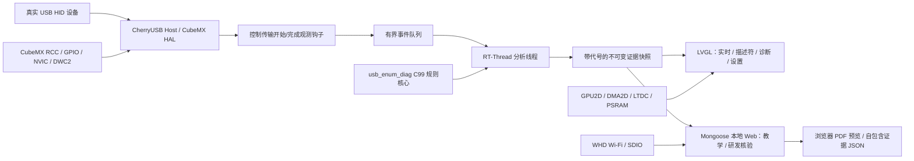

# USB 枚举可视化与描述符规则诊断仪：软件架构

## 数据路径

## 资源所有权

| 资源 | 硬件初始化权威 | 项目软件责任 |
|---|---|---|
| USB Host、时钟、GPIO、NVIC | CubeMX/HAL | CherryUSB 传输观测、RT-Thread 队列与快照 |
| SDIO/Wi-Fi | CubeMX/HAL | WHD 适配、Mongoose HTTP 服务 |
| LTDC/GPU2D/DMA2D | CubeMX/HAL | LVGL draw、统一 DMA/cache contract、错误统计 |
| 证据与规则 | 不适用 | `packages/usb_enum_diag` 纯 C99 核心 + 应用适配 |
| 教学与核验 | 不适用 | Web 共用同一代快照；LCD 显示其阶段与诊断摘要 |
| 故障恢复 | STM32 内部 IWDG、4 KiB BKPSRAM、Boot 外部 Flash 日志环 | RTOS/LVGL/Mongoose/LTDC 健康监督；周期保存 CPU 栈帧、线程与服务进度，Boot 复位后持久化 CRC 校验的最近现场 |

USB 时间是 Host 软件观测时间，不是 USB 总线分析仪时间。MCU 复位重枚举不等价于物理插拔。规则失败只能说明当前捕获字节与规则不符，不能单独证明设备硬件根因。

## 核验边界

- 正式 UI 不含内置合成故障入口、HIL 故障注入或离线证据导入。
- 独立的 C99 单元测试使用 fixture 构造规则输入；这些 fixture 只用于测试，不编入固件。运行时规则核心会编入固件，并处理 Host 捕获到的真实事件。
- 硬件验收只对当次发现的 HID、快照代号、原始事件 CRC 和错误计数负责，不固定历史事件数量或接口数。
